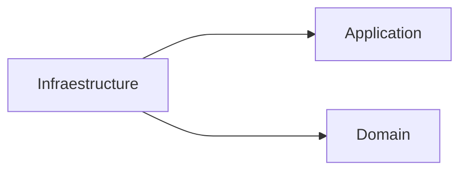
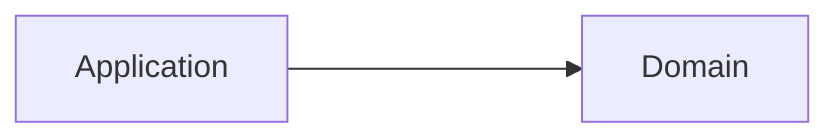

# visibility algorithm challenge

To address this challenge , I focused on a clean domain-driven architecture, I will give other details about this later.

The most relevant technologies that I used were :

 - Java 17
 - Springboot
 - Projectlombok
 - Project reactor
 - Junit
 - Maven

## Architecture

I faced this challenge thinking in define an hexagonal architecture , for this reason in the code you will find the following modules:

- Domain
- Application
- Infrastructure

Where there are clear rules about the hierarchy of visibility beetween them, something that implicitly promotes  SOLID principles.

We star talking about infrastructure module , this module can access to application and domain modules

on the other hand, the Application only will access to domain 

The domain is the layer where we will write the most important logic related to the bussiness , this module does not know another module and this is pretty good, our business logic will not depend on external implementations.

## Infrastructure 

Here we find the definition of two relevant points input and output , regarding input there is a class called ProductRepositoryImpl , in this one I implemented the code necessary to read the source data from csv files.

The other implementation in this module is the output of the logic processing, for this I created an endpoint in the ProductController class with the following path `/api/v1/products/available`

## Application

This is a module created to orchestrate the logic of the domain and invoke external services in classes that are known as use cases, for example for the challenge, it was used to orchestrate the logic mentioned in the cases, although in the domain there is logic of the business, there we can orchestrate this with the call to the service that retrieves the data related to the products.

My idea to define use cases is give more semantic to the class name , for example when you read a class with the followig name ´GetAvailableProductsOrderBySequence´ you can have an idea pretty aproximity about the content and responsability of this, it is important mentioned that ideally an usecase only should one public method

## Domain 

The domain is the module in charge of modeling our business (logic) and it is supported by defining the domain entities. The main characteristic of the domain entities is that they are not anemic classes, which means that they contain logic. For example, in this code you will find that the Product entity can of knowing if it has sizes in stock, if special sizes and any other business logic that arises should live in the domain.

## Challenge questions

- Una vez realizado el problema del algoritmo de visibilidad, comenta qué estructuras de datos (Listas, Sets, etc) has seleccionado para resolverlo y porque las has considerado como las más adecuadas en cada caso.

Respuesta : En el contexto de esta prueba técnica, se seleccionaron las siguientes estructuras de datos y enfoques por las siguientes razones :

Flux:

- Se eligió Flux debido a su naturaleza reactiva y capacidad para trabajar con flujos de datos y valores individuales de manera asíncrona.
La programación reactiva con ayuda de Project Reactor permite manejar flujos de datos en tiempo real y manejar altas cargas de trabajo de manera escalable si fuera necesario.
La reactividad de Flux se traduce en un código más limpio y conciso al permitir operaciones encadenadas y manipulación de flujos de datos de forma declarativa.
La capacidad de Flux para trabajar de forma asíncrona facilita el manejo de solicitudes concurrentes como en este caso la lectura de los archivos, lo que mejora la capacidad de procesamiento y evita bloqueos innecesarios.

Streams de Java:

Se utilizó la API de Streams de Java para procesar cierta información, como el mapeo de datos entre objetos DTO y entidades de dominio.
La API de Streams de Java ofrece una forma más funcional y declarativa de trabajar con colecciones de datos, lo que conduce a un código más legible y mantenible.
Al utilizar Streams, se pueden aprovechar operaciones como map(), filter() entre otras para realizar transformaciones y operaciones de filtrado y ordenamiento de manera más eficiente y concisa.

En general, manejar flujos de datos reactivos y la utilización de Streams de Java para operaciones locales de colecciones permitió obtener un código más limpio, claro y eficiente. Estas elecciones resaltan la capacidad de manejar concurrencia y flujos de datos de manera óptima, lo que resulta en un algoritmo de visibilidad más robusto y escalable en conjunto con la arquitectura definida.

- Complejidad temporal del algoritmo
Una vez resuelto el algoritmo de visibilidad. ¿Qué complejidad temporal expresada en notación “O”
crees que tiene? ¿Consideras que se podría mejorar de alguna manera?

Respuesta : Analizaria esta complejidad temporal desde 3 frentes , la lectura de los datos , el procesamiento de los datos a nivel de logica y finalmente la presentación de estos en el ednpoint creado.

Pienso que la complejidad temporal para este ejercicio esta bien y pensando un poco en esto decidí usar flujos de datos que nos permite tener complejiad O(n) , sin embargo la solución esta abierta cambios , por ejemplo en la lectura de los datos se pasa de un flujo de datos a listas y luego nuevamente a un flujo , este es un primer aspecto de mejora para impactar directamente en esta medida, otra podria ser en el modulo de aplicacion en el use case , dejar de usar ´sort´ y a cambio usar ´collectSortedList´, este ultimo es O(n), ya que solo necesita recorrer los elementos una vez para realizar la ordenación.

## Note 

The class to start the application lives in ´app´ module , this module is in charge of to run the project
